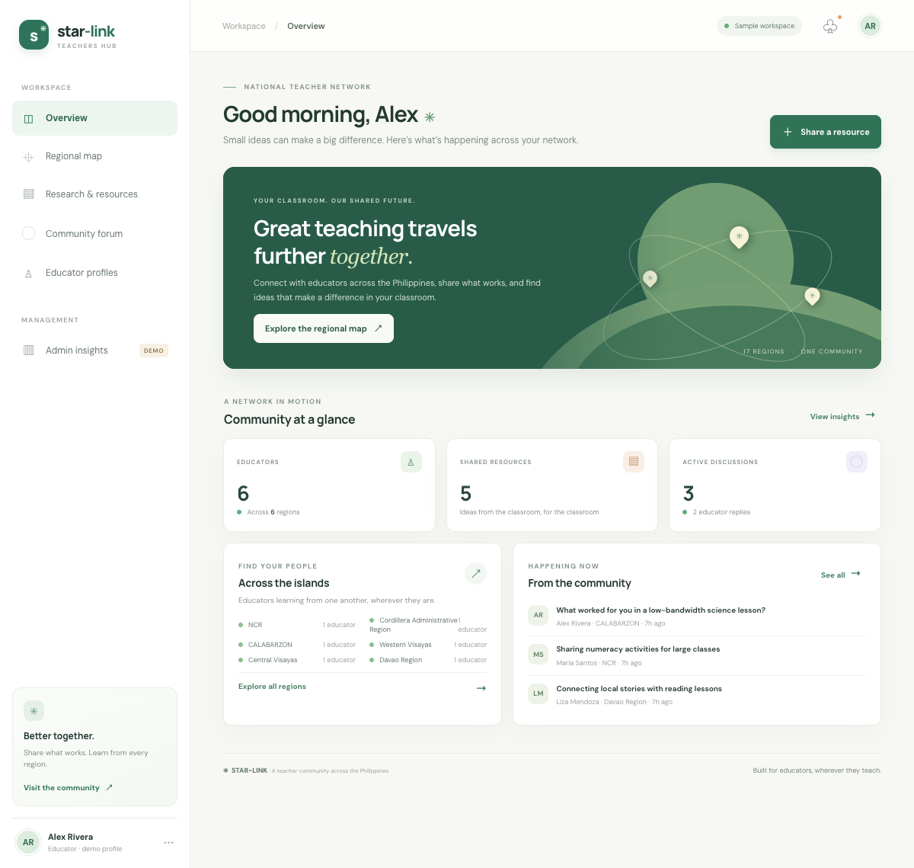
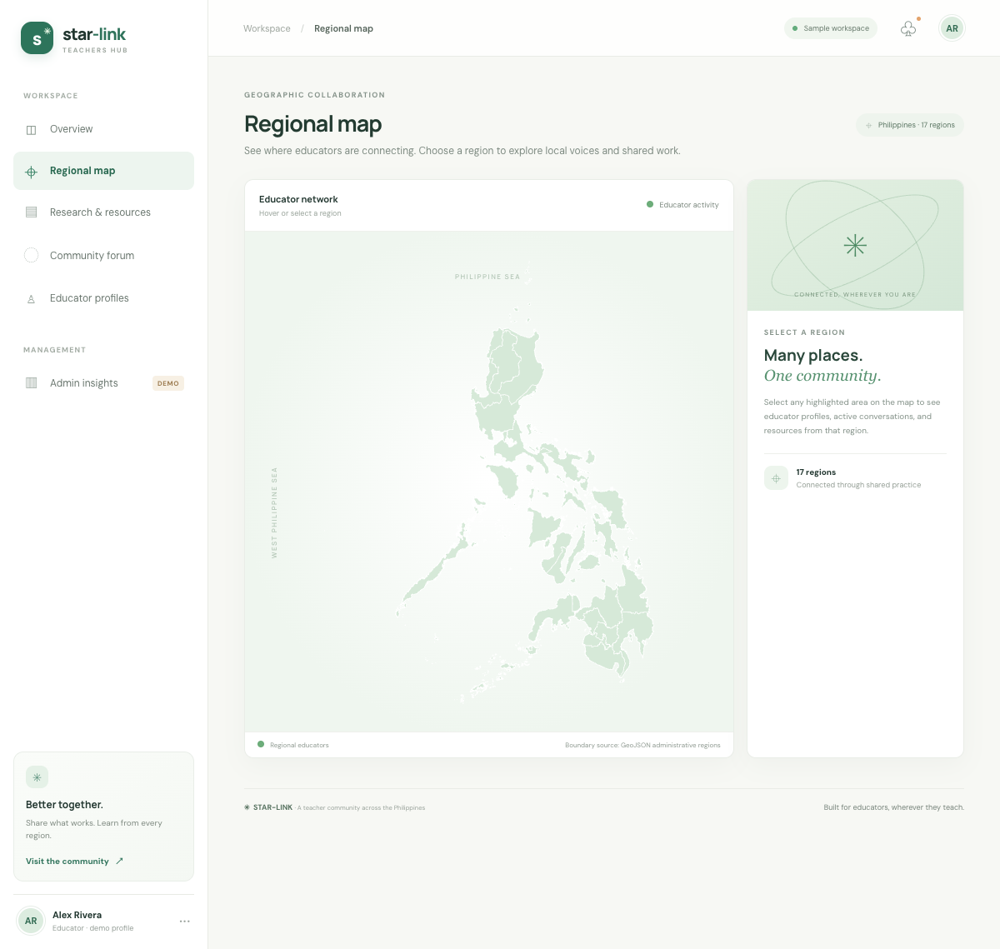
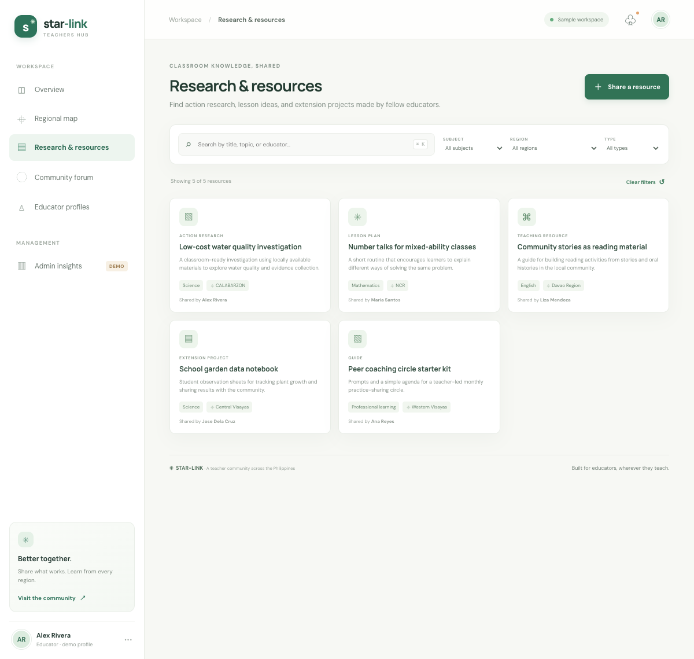
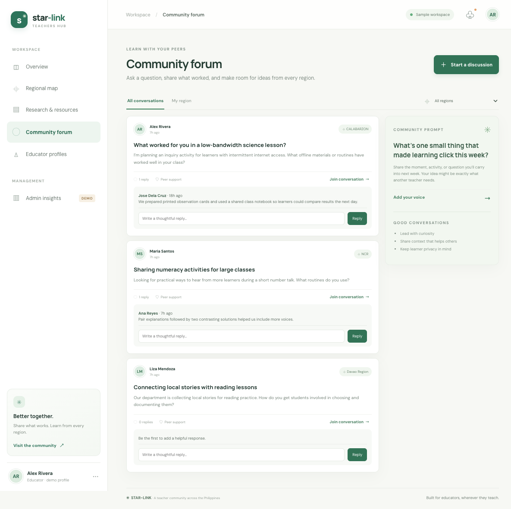
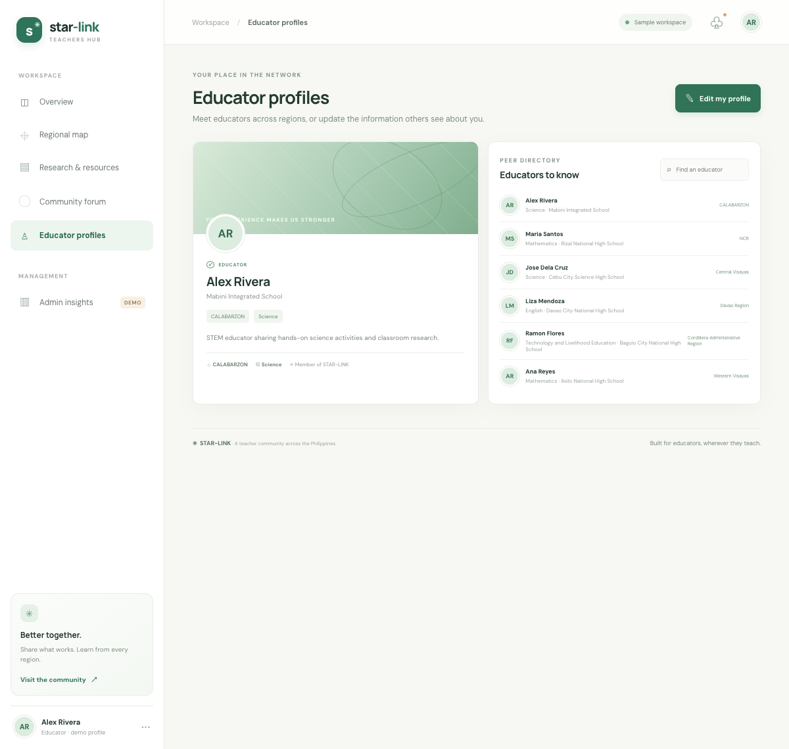
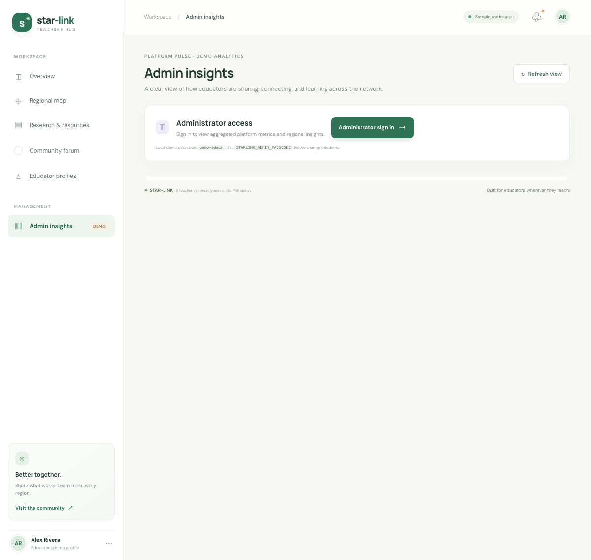
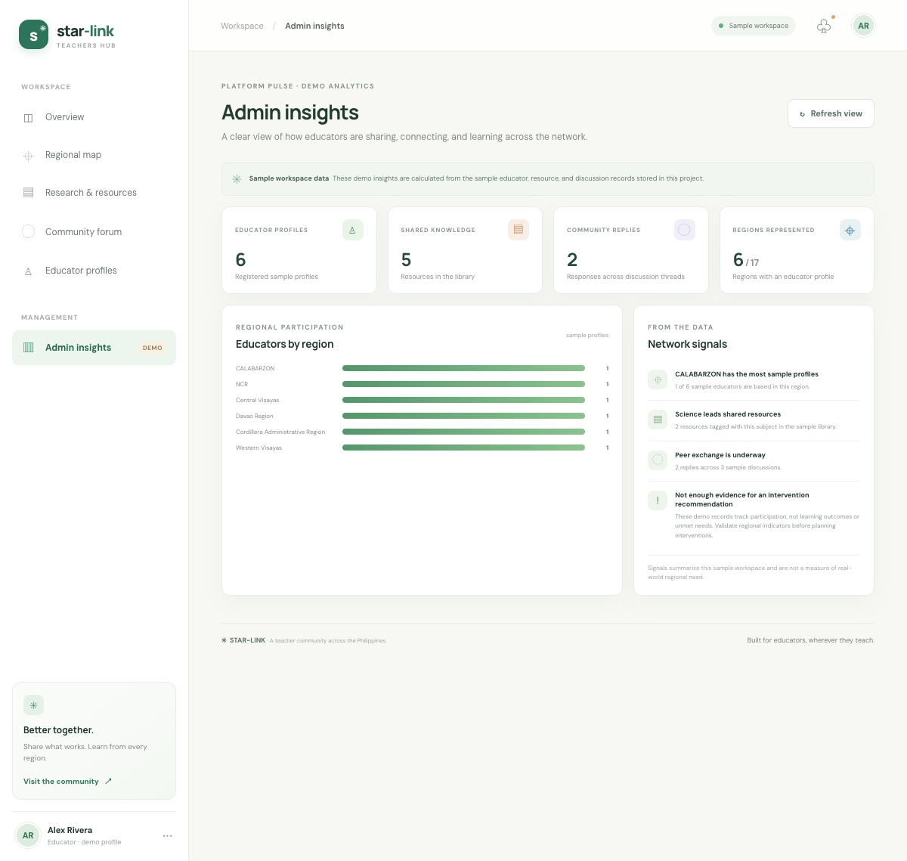

# STAR-LINK Sprint Hub (C#)

A compact ASP.NET Core recreation of STAR-LINK, the Philippine Teachers Hub, based on the supplied Azure DevOps Sprint 2 user stories. The project uses C# and Razor Pages, with a small JavaScript layer for live filtering and map interactions. It is an educational demo seeded with fictional sample records; it is not connected to real teacher accounts or a production database.

## Sprint stories represented

- **US 15 — Philippine regional collaboration map:** all 17 supplied administrative region boundaries render from the GeoJSON source. Select a region to view the sample profiles, resources, discussions, and replies. Scroll to zoom, drag to pan, double-click to reset; region overlays stay aligned.
- **US 18 — Administrator metrics:** a passcode-protected, read-only dashboard derives its counts, regional chart, and summary signals from the locally stored records. Empty datasets produce empty-state copy. Signals explicitly describe the demo dataset rather than real regional need.
- **US 13 — Educator profiles:** update the signed-in demo educator’s name, school, region, subject, and bio. Required fields are checked before saving; the directory is searchable.
- **US 17 — Regional indicators:** the map detail panel filters regional profiles, resources, conversations, and replies. No activity is shown as an empty state, not as evidence of need.
- **US 20 — Intervention insights:** the administrator view summarizes represented regions and shared-resource subjects from saved platform records.
- **US 4 — Search and filter resources:** search by title, summary, author, subject, or region; combine subject, region, and type filters; clear filters or see a no-results message.
- **US 7 — Threaded discussions:** create a discussion and add replies. Replies remain attached to their topic and appear after posting.

## Website screenshots

Captured from the running ASP.NET Core preview. Each screenshot shows the corresponding screen in the demo workspace.

| # | Screenshot | Screen | What it shows |
|---:|---|---|---|
| 1 |  | Overview | Network summary cards, represented regions, and current community discussions. |
| 2 |  | Regional map | Philippine administrative boundaries with region selection and regional activity details. |
| 3 |  | Research & resources | Search field, subject/region/type filters, and the shared research library. |
| 4 |  | Community forum | Regional discussion threads with replies and the community prompt. |
| 5 |  | Educator profiles | The editable demo profile and searchable educator directory. |
| 6 |  | Admin access | Sign-in gate shown before protected platform insights. |
| 7 |  | Admin insights | Profile/resource/reply counts, regional participation chart, and data-bounded signals. |

## Run locally

Requires the .NET 10 SDK.

```sh
dotnet run
```

Open the local URL printed by ASP.NET Core. The demo administrator passcode is `demo-admin`. Set `STARLINK_ADMIN_PASSCODE` to a private value before sharing the local demo. The sample profile, resources, topics, and replies are initialized on first run and saved to `App_Data/platform.json` after edits.

## Data and assets

- `PlatformStore.cs` defines the sample records and persists changes as JSON.
- `wwwroot/data/philippines-adm1.geojson` provides the 17 regional map boundaries, copied from the STAR-LINK reference project.
- Profile, resource, discussion, and reply writes use ASP.NET Core JSON endpoints.
- Authentication gates the administrator summary endpoint with an HTTP-only cookie. This is a local demonstration, not production account security or a production database setup.
